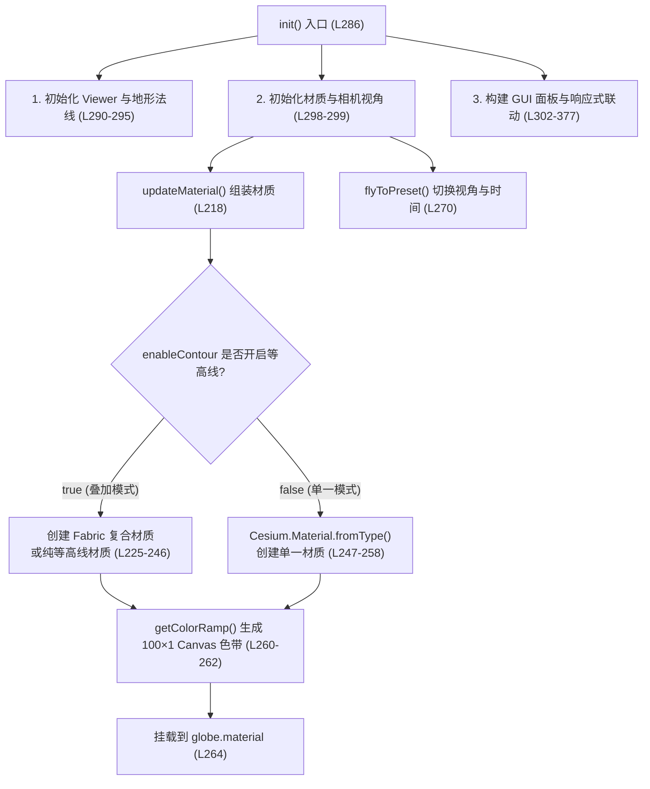

# Cesium 官方示例解读：地球材质（Globe Materials）

本文档对应官方 Sandcastle 示例 [Globe Materials](https://sandcastle.cesium.com/?id=globe-materials)，通过向 `viewer.scene.globe.material` 挂载内置材质与 Fabric 复合材质，实现地球地形表面的 **高程设色（Elevation）**、**坡度分析（Slope）**、**坡向分析（Aspect）** 以及 **等高线（Contour Lines）** 叠加渲染。

---

## 一、 为什么初始化地形时必须开启 `requestVertexNormals: true`？

```js
const viewer = new Cesium.Viewer("cesiumContainer", {
  terrain: Cesium.Terrain.fromWorldTerrain({
    requestVertexNormals: true, // Needed to visualize slope
  }),
});
```

- **作用**：向地形切片服务请求每个地形网格顶点的**三维法向量（Vertex Normals）**数据。
- **原因**：
  - **高程（Elevation）** 只需要知道每个片元的海拔高度 `h`，不依赖法向量。
  - **坡度（Slope，地表倾斜程度）** 和 **坡向（Aspect，山坡朝向方位）** 在片元着色器（Fragment Shader）中必须通过地表法向量与椭球面法向量的夹角及切空间投影计算得出。若不开启 `requestVertexNormals: true`，选择坡度或坡向模式时将无法正确渲染。

---

## 二、 Cesium 内置的 4 种地球表面材质

代码中通过 `Cesium.Material.fromType(type)` 调用了 Cesium 专门为 `Globe` 预置的 4 种着色器材质：

| 材质类型 (`type`) | 功能描述 | 核心 Uniform 参数 | 着色器底层逻辑 |
| :--- | :--- | :--- | :--- |
| **`ElevationRamp`** | **高程渐变设色** | `image`（1D 色带纹理）<br>`minimumHeight`（最低高程 `-414m` 死海）<br>`maximumHeight`（最高高程 `8777m` 珠峰） | 将当前片元的高程值线性归一化到 `[0.0, 1.0]`，作为纹理坐标去一维色带图 `image` 中采样对应颜色 |
| **`SlopeRamp`** | **坡度渐变设色** | `image`（1D 色带纹理） | 根据顶点法向量计算地形坡度角（`[0, π/2]`，即 `0° ~ 90°`），归一化到 `[0.0, 1.0]` 后去 `image` 中采样颜色 |
| **`AspectRamp`** | **坡向渐变设色** | `image`（1D 色带纹理） | 计算山坡朝向方位角（`0° ~ 360°`），归一化到 `[0.0, 1.0]` 后去 `image` 中采样颜色 |
| **`ElevationContour`** | **等高线** | `spacing`（等高距，单位：米）<br>`width`（等高线宽度，单位：像素）<br>`color`（等高线颜色） | 将片元海拔对 `spacing` 取模（求余数），并利用屏幕空间偏导数 `fwidth` 检测整数倍等高面边缘，在等高线处输出指定 `color`，其余区域 `alpha = 0.0` |

> **什么是“取模”？（等高线绘制原理解析）**
> - **取模（Modulo）就是“求余数”**（对应 JS 中的 `%` 运算符，或 GLSL 着色器中的 `mod(a, b)` 函数）；当**余数为 `0`** 时，就代表**刚好能被整除**。
> - **举例说明**：假设等高距 `spacing = 100`（每隔 100 米画一条等高线），着色器会对地形上每个像素的海拔 `height` 除以 `100` 求余数（`mod(height, 100)`）：
>   - 海拔 **`135米`**：`135 ÷ 100` **余数为 `35`** → 不在等高线上，保持透明（`alpha = 0.0`）。
>   - 海拔 **`200米`**：`200 ÷ 100` **余数为 `0`（刚好整除）** → 正好处于 100 米的整数倍高度上，绘制等高线颜色！
>   - 海拔 **`300米`**：`300 ÷ 100` **余数为 `0`（刚好整除）** → 同样绘制等高线颜色！
> - **配合 `fwidth` 控制线宽**：由于三维地形上很难有像素的海拔分毫不差等于 `200.00000` 米，着色器会结合 `fwidth`（计算相邻像素的海拔变化率），将余数接近 `0` 的那一圈像素（宽度由 `width` 决定，如 `2px`）都渲染为等高线颜色。

---

## 三、 什么是 Fabric？以及 `getXXXContourMaterial()` 复合材质的合成原理

### 1. `Fabric` 在 Cesium 中的含义与翻译
- **字面本意与隐喻**：`Fabric` 英文原意为 **“织物、布料”**，引申为 **“结构、构造方式”**。Cesium 官方将自己的 JSON 材质描述系统命名为 `Fabric`，是因为在三维图形学中，给几何体表面赋予材质就像给物体“穿上布料/织物”，并且它支持将多个子材质像“编织布料”一样交织组合成一个新材质。
- **中文技术译法**：在中文文档中通常保留英文专有名词，译为 **“Fabric 材质规范”**、**“Fabric 材质系统”** 或 **“材质结构定义”**（不建议生硬直译为“织物”）。
- **核心作用**：当编写 `new Cesium.Material({ fabric: { type, uniforms, materials, components, source } })` 时，`fabric` 就是告诉 Cesium 这块材质由哪些参数（`uniforms`）、哪些子材质（`materials`）和什么样的着色规则（`components` / `source`）构成，Cesium 会在底层将其自动编译拼接为完整的 WebGL GLSL 着色器代码。

### 2. `getXXXContourMaterial()` 复合材质合成逻辑

当用户**同时开启“渐变着色（高程/坡度/坡向）”与“等高线（Enable Contour Lines）”**时，`viewer.scene.globe.material` 只能挂载一个材质实例。因此需要利用 Cesium 的 **Fabric 复合材质机制** 将两个子材质组合在一起。

以 `getElevationContourMaterial()` 为例：

```js
function getElevationContourMaterial() {
  return new Cesium.Material({
    fabric: {
      type: "ElevationColorContour",
      // 1. 声明需要组合的子材质
      materials: {
        contourMaterial: {
          type: "ElevationContour", // 子材质 1：等高线
        },
        elevationRampMaterial: {
          type: "ElevationRamp",    // 子材质 2：高程色带
        },
      },
      // 2. 编写 GLSL 像素混合规则
      components: {
        // 如果当前像素不在等高线上（contourMaterial.alpha == 0.0），则显示高程渐变底色；
        // 如果在等高线上，则优先显示等高线颜色（contourMaterial.diffuse）
        diffuse:
          "contourMaterial.alpha == 0.0 ? elevationRampMaterial.diffuse : contourMaterial.diffuse",
        // 最终不透明度取两者的最大值
        alpha: "max(contourMaterial.alpha, elevationRampMaterial.alpha)",
      },
    },
    translucent: false,
  });
}
```

- `getSlopeContourMaterial()` 和 `getAspectContourMaterial()` 完全同理，仅将底层的 `ElevationRamp` 分别替换为 `SlopeRamp` 和 `AspectRamp`。

> **`components` 中 GLSL 表达式的白话拆解**
>
> 在 Cesium 的 Fabric 材质中，`components` 用于定义每个像素最终输出的外观属性，语法与 JavaScript 非常相似：
> 1. **两个核心属性**：
>    - **`diffuse`（漫反射颜色）**：决定当前像素最终显示**什么 RGB 颜色**。
>    - **`alpha`（不透明度）**：决定当前像素**是否透明**（`0.0` 为完全透明，`1.0` 为完全不透明）。
> 2. **`diffuse` 三元表达式解析（`条件 ? 结果A : 结果B`）**：
>    ```glsl
>    contourMaterial.alpha == 0.0 ? elevationRampMaterial.diffuse : contourMaterial.diffuse
>    ```
>    显卡在绘制地表每一个像素点时，都会执行这句判断：
>    - **问**：`contourMaterial.alpha == 0.0`（当前这个像素点在“等高线图层”上是不是透明的？即：**这里是不是没有等高线经过？**）
>    - **如果是（没有等高线）**：取 `?` 后面的 `elevationRampMaterial.diffuse` → **显示高程渐变的底色**。
>    - **如果否（正好在等高线上）**：取 `:` 后面的 `contourMaterial.diffuse` → **显示等高线的颜色（把底色盖住）**。
> 3. **`alpha` 最大值函数解析（`max(a, b)`）**：
>    ```glsl
>    max(contourMaterial.alpha, elevationRampMaterial.alpha)
>    ```
>    相当于 JS 中的 `Math.max()`，取两个子材质不透明度的较大值（因为渐变底色不透明度恒为 `1.0`，最终结果恒为 `1.0`，保证地表完全不透明）。

---

## 四、 `getColorRamp()`：用 HTML5 Canvas 动态生成 100×1 渐变纹理（1D LUT）

```js
const elevationRamp = [0.0, 0.045, 0.1, 0.15, 0.37, 0.54, 1.0];
const slopeRamp = [0.0, 0.29, 0.5, Math.sqrt(2) / 2, 0.87, 0.91, 1.0];
const aspectRamp = [0.0, 0.2, 0.4, 0.6, 0.8, 0.9, 1.0];

function getColorRamp(selectedShading) {
  const ramp = document.createElement("canvas");
  ramp.width = 100;
  ramp.height = 1;
  const ctx = ramp.getContext("2d");

  const grd = ctx.createLinearGradient(0, 0, 100, 0);
  grd.addColorStop(values[0], "#000000"); // 黑
  grd.addColorStop(values[1], "#2747E0"); // 蓝
  grd.addColorStop(values[2], "#D33B7D"); // 粉
  grd.addColorStop(values[3], "#D33038"); // 红
  grd.addColorStop(values[4], "#FF9742"); // 橙
  grd.addColorStop(values[5], "#ffd700"); // 黄
  grd.addColorStop(values[6], "#ffffff"); // 白

  ctx.fillStyle = grd;
  ctx.fillRect(0, 0, 100, 1);
  return ramp;
}
```

1. **为什么画布尺寸是 `100 × 1`？**
   着色器对高程/坡度/坡向的采样本质上是**一维颜色查找表（1D Color Lookup Table）**。`height = 1` 即可满足一维插值需求，开销极小。
2. **为什么三种模式的渐变断点（`values`）分布不同？**
   - **高程 (`elevationRamp`)**：全球海拔区间为 `[-414m, 8777m]`，但绝大多数平原和山地集中在 `0 ~ 2500m`（前 30% 区间），因此前 4 个颜色断点（`0.0, 0.045, 0.1, 0.15`）分布密集，使中低海拔地形也能呈现丰富的色彩对比。
   - **坡度 (`slopeRamp`)**：以 `sin(45°) = √2 / 2 ≈ 0.707` 为分界，突出陡坡与悬崖的颜色过渡。
   - **坡向 (`aspectRamp`)**：`0° ~ 360°` 各个朝向概率均等，因此断点均匀分布。

---

## 五、 `updateMaterial()` 状态机与工程化改造说明

1. **`updateMaterial()` 核心职责**：
   - 当切换着色模式（`selectedShading`）或开关等高线（`enableContour`）时，需要**重新构造对应的 `Cesium.Material` 实例**并赋值给 `viewer.scene.globe.material`。
   - 当仅调节等高距（`contourSpacing`）、等高线宽度（`contourWidth`）或等高线颜色（`contourColor`）时，无需重建材质，直接修改 `contourUniforms` 对象的属性即可实时生效。
2. **Vue 3 + `lil-gui` 改造**：
   - 官方原示例使用了早期的 `Cesium.knockout` 进行表单双向绑定，以及 `Sandcastle.addToolbarMenu` 切换预设相机视角。
   - 在本项目的 `index.vue` 实现中，已移除 `knockout` 和 `Sandcastle` 依赖，统一采用项目内置的 `createGUI`（`lil-gui`）构建交互控制面板。


---

## 六、 细节剖析：为什么 `Cesium.Color.RED.clone()` 必须调用 `.clone()`？

```js
const contourColor = Cesium.Color.RED.clone();
```

这里涉及 Cesium 的**只读常量保护机制**与**内存复用（`result` 参数）设计模式**：

1. **`Cesium.Color.RED` 是被 `Object.freeze()` 冻结的全局只读常量**
   在 Cesium 源码中，所有预定义颜色常量（如 `Cesium.Color.RED`、`Cesium.Color.WHITE`）在初始化时均通过 `Object.freeze()` 冻结：
   ```js
   Color.RED = Object.freeze(Color.fromCssColorString("#FF0000"));
   ```
   这是为了防止某处代码意外修改了全局的 `Cesium.Color.RED`，导致整个应用中所有引用该常量的对象颜色被污染。

2. **后续变色操作使用了 `result` 参数进行原地属性修改（In-place Mutation）**
   在随机切换颜色或通过颜色选择器修改颜色时：
   ```js
   // 第二个参数 contourColor 作为 result 传入，直接原地修改其 red/green/blue/alpha 属性
   Cesium.Color.fromRandom({ alpha: 1.0 }, contourColor);
   Cesium.Color.fromCssColorString(val, contourColor);
   ```
   Cesium 为了避免高频交互时频繁 `new Cesium.Color()` 产生垃圾回收（GC）开销，设计了第二个参数 `result`，将计算出的新通道值直接写入 `contourColor` 实例内部：
   - **如果不调用 `.clone()`**：`contourColor` 指向被冻结的只读对象，执行 `fromRandom(..., contourColor)` 修改属性时会直接报错：`TypeError: Cannot assign to read only property 'red' of object`。
   - **调用 `.clone()` 后**：创建一个**全新的、可变的（Mutable）`Color` 实例**，既能安全地复用同一个对象引用（让 `contourUniforms.color` 自动感知内部值变化），又不会污染全局常量。

---

## 七、 从 `init()` 入口梳理整体实现思路

从 `index.vue` 的 `init()` 函数出发，整个示例的执行与交互链路分为 **3 个核心步骤**：



### 第一步：初始化带“顶点法线”的地形地球

```js
viewer = createViewer(containerRef.value, {
  terrain: Cesium.Terrain.fromWorldTerrain({
    requestVertexNormals: true,
  }),
});
optimizeViewerQuality(viewer);
```

- **核心点**：除了加载全球地形外，显式传入了 `requestVertexNormals: true`。
- **原因**：虽然默认的“高程设色 (`elevation`)”只需要海拔高度，但用户在面板里随时会切换到“坡度 (`slope`)”或“坡向 (`aspect`)”，后两者在 GPU 着色器中必须依赖每个地形网格顶点的**三维法向量**才能算出山坡倾角和朝向，因此在初始化地形时就要一并向地形服务请求法线数据。

### 第二步：首次挂载材质并定位默认视角

```js
updateMaterial();
flyToPreset(viewModel.location);
```

#### 1. `updateMaterial()` —— 材质组装的核心状态机
地球表面材质由两个开关共同决定：**是否开启等高线 (`enableContour`)** × **4 种底色模式 (`selectedShading`: `elevation` / `slope` / `aspect` / `none`)**，一共 **8 种组合**：

1. **分支 A：未开启等高线（`hasContour === false`）**
   - 直接调用 `Cesium.Material.fromType(...)` 创建 Cesium 内置的单一材质（`ElevationRamp`、`SlopeRamp` 或 `AspectRamp`）。
   - 如果选的是 `"none"`（无着色），`material` 保持为 `undefined`，最后赋值给 `globe.material` 时就会恢复地球原本的卫星影像底图。
   - 同时把 `material.uniforms` 的引用保存在外部变量 `shadingUniforms` 中。
2. **分支 B：开启了等高线（`hasContour === true`）**
   - 当底色是高程/坡度/坡向时，需要把**底色渐变**和**等高线**两层合二为一，因此分别调用 `getElevationContourMaterial()`、`getSlopeContourMaterial()` 或 `getAspectContourMaterial()` 构造 **Fabric 复合材质**。
   - 复合材质内部有两套子材质，代码将它们的 `uniforms` 分别提取到模块级变量 `shadingUniforms`（控制底色色带）和 `contourUniforms`（控制等高线线宽、间距、颜色）。
   - 如果底色选了 `"none"` 但开了等高线，则只创建单一的 `ElevationContour` 材质，让等高线直接画在卫星影像上。
3. **生成 `100 × 1` 色带画布**
   - 只要底色不是 `"none"`，就调用 `getColorRamp(selectedShading)` 在内存中创建一个宽 100 像素、高 1 像素的 `<canvas>`，按照对应模式的 7 个百分比断点（`elevationRamp` / `slopeRamp` / `aspectRamp`）填入黑→蓝→粉→红→橙→黄→白渐变，并赋给 `shadingUniforms.image` 供 GPU 采样。
4. **挂载生效**：`globe.material = material`。

#### 2. `flyToPreset(viewModel.location)` —— 视角与光照时间同步
- 默认读取 `viewModel.location`（`"himalayas"`），从 `PRESET_VIEWS` 配置表中取出喜马拉雅山脉的坐标与相机朝向，调用 `viewer.camera.setView` 瞬移过去，并同步设置当时的太阳光照时间 `clockViewModel.currentTime`。

### 第三步：构建 GUI 面板与“两级更新”性能设计

在绑定 `lil-gui` 控件的 `onChange` 回调时，代码做了一个很重要的**两级更新区分**：

1. **结构级切换 → 调用 `updateMaterial()` 重建材质**
   - 当切换**地表着色模式**或切换**启用等高线复选框**时，底层使用的 GLSL 着色器类型发生了变化（比如从单材质变成复合材质），因此必须重新执行 `updateMaterial()` 生成新的 `Cesium.Material` 实例。
2. **参数级微调 → 直接修改 `contourUniforms` 属性引用（不重建材质）**
   - 当用户高频拖动**等高距滑块**、**等高线宽滑块**、**颜色选择器**或点击**随机颜色**时，**不会**调用 `updateMaterial()`。
   - 而是直接修改之前保存好的 `contourUniforms.spacing`、`contourUniforms.width`、`contourUniforms.color`。这样避免了拖动滑块时反复销毁和重编译 WebGL Shader，保证滑动过程丝滑不掉帧。
3. **控件禁用态联动（`syncContourCtrlState`）**
   - 当 `enableContour` 为 `false` 时，自动调用 `ctrl.disable(true)` 将等高距、线宽、颜色、随机颜色这 4 个子控件置灰禁用；勾选启用后再解除禁用。

