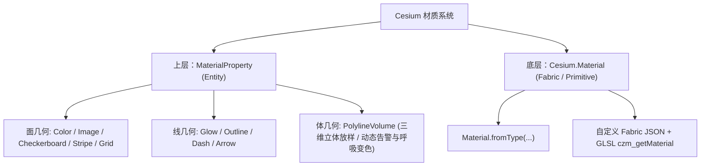

# Cesium 核心材质与纹理体系 (Material & MaterialProperty)

## 一、技术架构：两层材质体系

Cesium 的材质系统分为 **Entity 上层属性材质** 与 **Primitive 底层 Fabric 材质** 两个层级：



---

## 二、面状几何常用材质 (Surface Materials)

适用实体类型：`ellipse`、`polygon`、`rectangle`、`wall`、`corridor`。

### 1. ColorMaterialProperty（纯色与透明度）
```javascript
ellipse.material = Cesium.Color.fromCssColorString('#3b82f6').withAlpha(0.8);
```

### 2. ImageMaterialProperty（图片纹理与重复度）
```javascript
ellipse.material = new Cesium.ImageMaterialProperty({
  image: '/path/to/texture.png',
  repeat: new Cesium.Cartesian2(4, 4), // X, Y 轴平铺重复次数
  transparent: true
});
```

### 3. CheckerboardMaterialProperty（黑白/双色棋盘格）
```javascript
ellipse.material = new Cesium.CheckerboardMaterialProperty({
  evenColor: Cesium.Color.WHITE,
  oddColor: Cesium.Color.BLACK,
  repeat: new Cesium.Cartesian2(4, 4)
});
```

### 4. StripeMaterialProperty（条纹带与动态走马灯）
结合 `CallbackProperty` 动态修改 `offset`，可实现水流、电力跑马灯动画：
```javascript
let offset = 0;
ellipse.material = new Cesium.StripeMaterialProperty({
  orientation: Cesium.StripeOrientation.VERTICAL,
  evenColor: Cesium.Color.WHITE,
  oddColor: Cesium.Color.BLUE,
  repeat: 16,
  offset: new Cesium.CallbackProperty(() => offset, false)
});
```

### 5. GridMaterialProperty（经纬网格线框）
```javascript
ellipse.material = new Cesium.GridMaterialProperty({
  color: Cesium.Color.YELLOW,
  cellAlpha: 0.15,
  lineCount: new Cesium.Cartesian2(8, 8),
  lineThickness: new Cesium.Cartesian2(2.0, 2.0)
});
```

---

## 三、线状几何专用材质 (Polyline Materials)

适用实体类型：`polyline`。

| 材质类名 | 视觉表现 | 核心配置项 | 典型业务场景 |
| :--- | :--- | :--- | :--- |
| **`PolylineGlowMaterialProperty`** | 发光光晕能量线 | `glowPower`: 发光扩散度<br>`taperPower`: 尾部衰减度 | 夜景航线、能量传输、雷达光线 |
| **`PolylineOutlineMaterialProperty`** | 双色描边折线 | `color`: 核心填充色<br>`outlineColor`: 外边框色<br>`outlineWidth`: 边框厚度 | 复杂山体与高对比地形边界 |
| **`PolylineDashMaterialProperty`** | 虚线间隔效果 | `dashLength`: 虚线分段长度<br>`gapColor`: 间隙虚位填充色 | 施工航线、规划预测路线、境界线 |
| **`PolylineArrowMaterialProperty`** | 末端箭头导向线 | `color`: 箭头整体颜色 | 单向流向指示、道路巡查导向 |

---

## 四、实战落地：工业管网/危化泄漏告警与动态呼吸变色

在真实数字孪生、智慧水务与化工园区中，普通 2D 线条无法表达管道真实的管径（DN500/DN1000）和立体位置，必须使用 **`PolylineVolume`（三维多边形截面放样）**。

当发生超压预警或介质泄漏时，利用 **`CallbackProperty` 挂载正弦呼吸波算法**，驱动材质在每帧渲染时动态变色，兼具零GC、无卡顿的高性能优势。

### 1. 截面生成辅助函数
```javascript
function computeCircle(radius, points = 32) {
  const positions = [];
  for (let i = 0; i < points; i++) {
    const rad = (i / points) * Cesium.Math.TWO_PI;
    positions.push(
      new Cesium.Cartesian2(radius * Math.cos(rad), radius * Math.sin(rad))
    );
  }
  return positions;
}
```

### 2. 工业管网泄漏与告警呼吸脉冲算法
```javascript
// 告警管段实体
alarmPipe = viewer.entities.add({
  name: "危化液氨管线",
  polylineVolume: {
    positions: Cesium.Cartesian3.fromDegreesArrayHeights([...]),
    shape: computeCircle(500.0), // 真实放样直径
    cornerType: Cesium.CornerType.ROUNDED,
    // 动态工况响应材质
    material: new Cesium.ColorMaterialProperty(
      new Cesium.CallbackProperty(() => {
        // 突发泄漏告警：剧烈红黑/红亮呼吸爆发脉冲 (5Hz 快速警示)
        if (isLeaking) {
          const pulse = 0.5 + 0.5 * Math.sin(tickTime * 5.0 * Math.PI);
          return new Cesium.Color(1.0, 0.15 * pulse, 0.15 * pulse, 0.4 + 0.6 * pulse);
        }
        // 超压预警：黄色中速呼吸 (2Hz)
        if (isWarning) {
          const pulse = 0.5 + 0.5 * Math.sin(tickTime * 2.0 * Math.PI);
          return new Cesium.Color(1.0, 0.75 + 0.25 * pulse, 0.05, 0.5 + 0.5 * pulse);
        }
        // 正常工况：安全青绿稳态
        return Cesium.Color.fromCssColorString("#10b981").withAlpha(0.9);
      }, false)
    )
  }
});
```

---

## 五、底层 Fabric 与 Material.fromType 体系

在底层 Primitive（如 `GroundPrimitive`、`Primitive`）中，通常直接使用 `Cesium.Material`：
```javascript
const material = Cesium.Material.fromType('Grid', {
  color: Cesium.Color.YELLOW,
  cellAlpha: 0.2,
  lineCount: new Cesium.Cartesian2(8, 8),
  thickness: new Cesium.Cartesian2(2.0, 2.0)
});

const primitive = new Cesium.Primitive({
  geometryInstances: instance,
  appearance: new Cesium.MaterialAppearance({ material })
});
```
