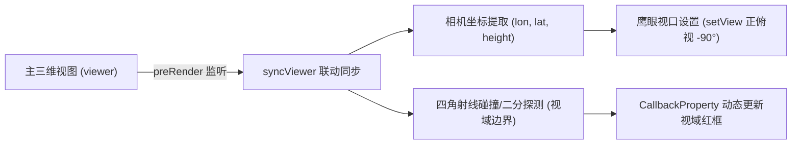

# Cesium 鹰眼地图 (Eagle Eye / Overview Map)

## 一、核心原理与技术架构

在三维 GIS 系统中，**鹰眼地图（Overview Map / Mini-Map）** 是帮助用户快速定位主视角在全局地理空间中方位的必备组件。

本方案基于 **双 Cesium Viewer 实例联动** + **preRender 每帧无损视域推导** 构建：



---

## 二、关键技术点与踩坑避坑

### 1. 视域梯形（Frustum Extent）的精准投影与抗异常
- **普通简单矩形计算的缺陷**：在主相机处于高倾斜俯仰角（Pitch < -45°）或大偏航角（Heading）旋转时，传统的经纬度外包框会剧烈变形甚至翻转。
- **四角屏幕射线求交算法**：
  - 拾取主屏幕 Canvas 的四个角 `[左下, 右下, 右上, 左上]`；
  - 借助 `scene.camera.pickEllipsoid(screenPos, ellipsoid)` 投影到地表；
  - **关键防御**：当相机大角度仰拍（天空）或全球超远距离观察时，屏幕角点在地球轮廓外部。采用**从屏幕中心向边缘二分逼近切线地平线**的方法，完美杜绝投影出现 `undefined` 导致的视域框丢失或崩溃。

### 2. 极致性能保障（60 FPS 零垃圾回收）
- 视域范围线使用 `new Cesium.CallbackProperty(() => closedPositions, false)`，仅在内存中更新顶点坐标数组，**无需在每帧销毁并重建 Entity**；
- 视域边框指定 `arcType: Cesium.ArcType.NONE`，采用纯直线段连接，省去球面大圆航线的密集剖分与三角网开销；
- 共享 `ClockViewModel`，并在组件卸载时严密注销 `preRender` 事件监听与双 Viewer 实例。

### 3. 鹰眼视图的控制锁死
鹰眼小地图仅承担导航预览职责，必须锁定用户操作避免手势误触造成双向冲突：
```javascript
const controller = viewerEagle.scene.screenSpaceCameraController;
controller.enableRotate = false;
controller.enableTranslate = false;
controller.enableZoom = false;
controller.enableTilt = false;
controller.enableLook = false;
```

---

## 三、常用配置与调优建议

| 配置项 | 推荐值 | 说明 |
| :--- | :--- | :--- |
| **高空倍率比例 (scaleRatio)** | `3.0` | 鹰眼高度 = 主图高度 × 3.0，保持小窗口有恰当的全局宏观感。 |
| **高度区间限制 (Clamp)** | `300m ~ 20,000,000m` | 防止贴近地面时鹰眼过度拉近，同时保证全球远景时完整收纳地球。 |
| **俯仰角 (Pitch)** | `-90° (垂直正俯视)` | 保证鹰眼始终呈现 2D 正射小地图效果。 |
| **航向角 (Heading)** | 与主图 `camera.heading` 实时同步 | 确保鹰眼指北与主相机旋转方向一致。 |

